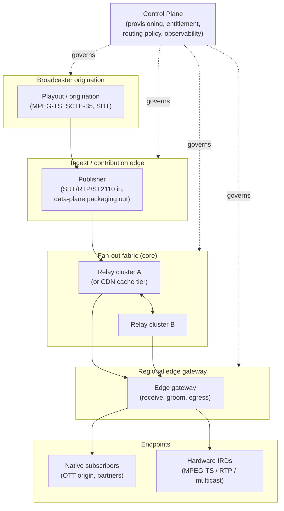
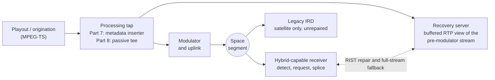
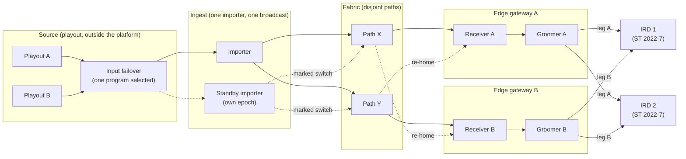

# Reference Architecture: Broadcast-Grade Primary Distribution

Status: working draft.
Layer: **above the transport.** Everything in §4–§9 is required and owned by the distributor
*whichever* data plane carries the bytes, and is the substance of this repository. Only §6 (carriage
lanes) and §8 (the fan-out fabric) are MoQ-specific; their segmented-HTTP counterparts are in
[Comparison](comparison.md) §8 and §2.

Scope: an end-to-end reference architecture for a platform that delivers professional broadcast
primary distribution over an Internet-native transport. It takes the requirement set in
[Problem](problem.md) §5 as given and develops R3 (IRD-conformant egress), R6 (redundancy) and R8
(observability). MoQ is used as the worked example because it is what the
prototype runs on; the transport-specific parts are marked.

The edge gateway (§4) and redundancy (§5) come first — broadcast-grade components and where most
measurement sits. §6 onward is carriage, fabric, operations and design intent.

---

## 1. Purpose and layering

This is deliberately *not* a description of MoQ. The subject is the entire distribution platform —
publishers, relays, edge gateways, egress, control plane, entitlement, observability and operations.
The transport is one layer among several, and by design the least differentiated.

Throughout, three planes are kept separate, because conflating them is the most common source of
architectural error in this domain: the **data plane** (the path media takes from publisher to
endpoint), the **control plane** (the system that provisions, entitles, routes and observes), and the
**management plane** (the human-facing surfaces: APIs, dashboards, NOC integration). Their
availability, latency and consistency requirements are radically different.

### 1.1 Design principles

Derived from [Problem](problem.md) §1 and §5, and governing every decision below.

1. **The installed base is non-negotiable.** The platform must deliver IRD-grade MPEG-TS to existing
   hardware without modification to that hardware. Any design that requires replacing receivers is
   rejected on arrival — which is the line that separates this architecture from the satellite-hybrid
   model sketched in §2.1, where the repair function can only sit inside a new receiver.
2. **The transport is a swappable dependency.** Because the transport commoditises and is currently
   wire-unstable, the media packaging, control, entitlement and egress layers must be independent of
   the specific transport draft. The value must survive a transport change.
3. **Control-plane and data-plane failures are independent.** A control-plane outage must never take
   down established media flows. The data plane must run on last-known-good state.
4. **Determinism at the edge, elasticity in the core.** The unpredictable public Internet is absorbed
   by grooming and buffering at the egress edge so that the IRD sees a deterministic stream. The core
   relay fabric is elastic and software-defined.
5. **Fail safe, deny by default.** Entitlement, admission and routing default to the safe state. An
   expired or ambiguous entitlement denies delivery; it does not fall open.
6. **Everything is observable and auditable.** If it cannot be observed, it cannot be operated for
   contracted content.

---

## 2. End-to-end overview

Solid lines are the media data plane; dotted lines are control-plane governance. Two deliberate
properties, one simplified in the diagram: native subscribers can subscribe directly from the fabric
without an edge gateway (they need no grooming — a path not drawn), whereas hardware IRDs always sit
behind an edge gateway performing the broadcast-grade adaptation. The control plane touches every
component and sits on none of the media paths.

**The fabric box is the only part that changes with the data plane.** On MoQ it is a relay cluster
(§8); on segmented HTTP it is an origin plus a cache tier. Everything to the right of it is identical.

### 2.1 The satellite-hybrid topology, for contrast

The architecture above puts a cache where satellite puts a footprint. **The satellite-hybrid model of
[Comparison](comparison.md) §10.2 does the opposite: it keeps the space segment as the fan-out and adds
IP only as a repair path.** It is drawn for the contrast about where the broadcast-grade work goes, not
because this repository has measured any of it — everything here is *specified*, from VSF TR-06-4
Parts 7 and 8.

**The tap is the only change to the transmit chain, and the two parts differ on how invasive it is.**
Part 7 inserts metadata markers into the transport stream ahead of the modulator, so it is an active
element that needs null-packet bandwidth to work with; Part 8 tees the stream passively and leaves it
bit-identical. Either way the recovery server must see the *pre-modulator* stream, because that is the
reference every repair is drawn from — and because the modulator is free to add or delete null packets
and re-stamp PCRs for rate matching, which is exactly why neither part is allowed to correlate on null
distribution or on exact PCR values.

**The recovery server is a tier, not a box.** It holds an RTP representation of the feed in a buffer
the specifications size at satellite round trip plus the worst-case internet latency to any receiver —
"on the order of several seconds" — and both parts warn that one server will not serve a large estate,
so the real deployment is a load-balanced, geographically distributed bank fed by whichever headend is
live. That buffer is the same depth-versus-latency trade §4.2 examines on the MoQ lane, sized by
satellite round trip instead of by peak coded frame.

**The receiver is where the burden lands, and it splits the estate in two.** A hybrid-capable receiver
needs loss detection, a RIST client, a buffer at least as deep as the satellite latency plus margin for
the internet round trip and the repair block, and a splice function that keeps PCR continuity across
the join — which, per Part 8's own splicing guidance, means setting the discontinuity indicator or
interpolating PCRs to avoid breaching the ±500 ns accuracy requirement this document spends §4 on.
Legacy IRDs keep decoding the satellite stream unchanged and simply receive no repair.

**So the broadcast-grade stages do not disappear; they change owner.** There is no fabric and no edge
gateway, redundancy becomes 1+1 across headends and recovery-server networks rather than across relay
legs (§5), and the grooming-shaped problem — PCR integrity at a splice — moves inside equipment the
distributor does not own (§3). That is the same conclusion this document reaches for the
Internet-native planes, from the other end.

---

## 3. What the installed base requires

The existing receiving plant is not a component the platform builds; it is a constraint the platform
must satisfy. It is stated before the design because designing as though it were optional is the most
common way Internet-native distribution proposals fail.

A hardware IRD or professional decoder expects, at minimum:

- A conformant MPEG-2 transport stream over its supported interface (ASI, or increasingly RTP/UDP
  over IP, frequently multicast).
- **TR 101 290 P1/P2 conformance — above all conformant PCR timing.**
- Stable service signalling: a consistent PMT PID, correct SDT service identity, and preserved
  SCTE-35, teletext and subtitling.
- ST 2022-7 dual-path input for redundancy, in facilities that use it.

The egress the platform therefore specifies is MPEG-TS over RTP/UDP (payload type 33) and raw UDP,
unicast or multicast; SMPTE 2022-1 FEC for loss protection on the egress network; ST 2022-7 hitless
dual-path; and decoder-safe start gating with de-jitter pacing. The groomer used here sends RTP or raw
UDP to a unicast or multicast address and, stream-clocked, numbers a pair identically; upstream's export
writes a byte stream and leaves RTP to such a stage; nothing here implements 2022-1 FEC. Multicast and
FEC are *egress implementation details*, reconstructed at the edge to match the local plant and
decoupled from how the feed traversed the fabric. ST 2022-7 is not: two legs merge only if both send
the same RTP datagrams, which constrains every stage from the importer down (§5.1).

**Coexistence architecture** — receivers, plant and monitoring stay untouched ([Problem](problem.md)
§2.4); native subscribers can bypass the edge gateway, but never as a requirement. That is a
property of *this* architecture rather than of IP distribution generally: the satellite-hybrid
alternative in §2.1 buys its repair path with a receiver upgrade at every site that is to benefit.

### 3.1 Ingest

The platform ingests the transports broadcasters already use, in descending order of near-term
importance: **RTP/UDP MPEG-TS** including SMPTE 2022-1 FEC and ST 2022-7 dual-path, the established
managed-network format; **SRT**, the dominant IP contribution transport, ingested to coexist with
existing workflows rather than demand replacement; and **ST 2110 essence** in the longer term, which
requires encode/mux before publication and is a heavier integration with its own PTP considerations.

Ingest is a pluggable adaptation layer with no privileged input: the internal representation is a
transport stream, and each ingest module must produce it faithfully. That order is design: every
ingest measured here is SRT or plain UDP, and none is RTP with FEC or a 2022-7 merge.

---

## 4. The edge gateway: grooming and egress

**This is the component that makes the architecture broadcast-grade, it is required in the same place
with the same responsibilities on either data plane, and it is where nearly all the measured work in
this repository sits.**

An edge gateway receives one or more feeds from the nearest fan-out point and, for each configured
egress, performs in order:

1. **Reassembly** into a contiguous MPEG-TS byte stream, preserving the original TS structure.
2. **Grooming** — the broadcast-grade adaptation described in §4.1.
3. **Egress formatting** — RTP/UDP or raw UDP, unicast or multicast, with optional SMPTE 2022-1 FEC
   and ST 2022-7 dual-path output.
4. **De-jitter pacing and a decoder-safe start gate** so the IRD sees a smoothly paced stream and
   starts cleanly.
5. **Read-only TR 101 290 monitoring** of its own output, feeding observability (§9).
6. **Deterministic output** when the gateway is one half of an ST 2022-7 pair (§5.1).
7. **Silence detection and mute** when its content source stops (§5.3). This is not optional and it
   is not obvious; it is the failure mode a component-liveness list misses.

### 4.1 The grooming problem, and why it belongs to every data plane

**Any Internet-native transport delivers media in bursts. Where the lane rebuilds or alters the
multiplex, the reassembled stream's PCR fails TR 101 290 — the conformance the installed base
enforces (§3); where it carries the bytes verbatim the PCR passes, but the bursts reach the IRD as
arrival jitter its clock recovery must absorb. No hardware receiver's reaction to either has been
observed here. Grooming is the fix, it sits at the edge, and it is required whichever data plane
carries the bytes.**

It is tempting to read this as a cost of MoQ's object model, and measurement says the opposite:
**segmented HTTP is the harder case, by two orders of magnitude.** Carrying the same clip, MoQ's
egress arrives in 12.4 kB bursts with a worst-case silence of 149 ms, while classic HLS arrives in
2.95 MB bursts with 24 silences over a second and a worst case of 4.01 s
([Evidence](../lab/evidence.md) §3.8).

**Three distinct things are easily conflated** ([Evidence](../lab/evidence.md) §3.8): (1) **delivery cadence**
— burst arrival changes *when* PCR-bearing packets reach the edge, shared by every Internet-native
candidate (the tunnels re-pace in their receivers' latency buffers; segmented HTTP needs a groomer),
while a byte-faithful lane keeps the PCR values and their byte positions; (2) **timestamp
regeneration** — media-aware MoQ must re-mint PCR/PTS/DTS and lay out a multiplex of its own, which
segmented HTTP and the opaque MoQ lane avoid;
(3) **delivery timing at the output** — whether packets reach the IRD steadily enough for its clock
recovery, which TR 101 290 grades on arrival as the PCR's overall jitter and, on IP, as the delay
factor. PCR *accuracy*, the ±500 ns check, is the PCR value against its byte position at the mux
rate: a property of the bytes, graded the same from a file or a capture. Grooming absorbs (1) in its
buffer, rebuilds the constant-rate layout with accurate PCRs that (2) leaves irregular, and sets (3)
by its own pacing; it cannot restore what (2) discards, and the opaque lane sidesteps (2).

**What grooming does.** It (a) **re-inserts null packets** (PID `0x1FFF`) to pad the reassembled
stream back to the target mux rate, since nulls are commonly stripped for efficient transport — on the
media-aware lane the exporter now does this itself, so the groomer inherits a padded stream rather
than an unpadded one; (b)
**paces the output as a byte-locked constant bit rate**; and (c) applies a **monotonic PCR re-stamp
and PCR re-insertion** so PCR values are byte-accurate against the reconstructed CBR clock rather
than merely approximately correct.

This is *re-timing*, not re-multiplexing — PIDs, PES, SCTE-35 and service signalling stay untouched,
and so does packet order. That is sufficient where the delivered order is the source multiplexer's.
Behind the media-aware lane it is not: that lane discards the packet schedule the 13818-1 buffer model
depends on, and a re-timing stage cannot rebuild it (§4.3).
Behind MoQ all three steps (a)–(c) are required and no off-the-shelf stage preserves the mux; behind
segmented HTTP the packager has already preserved stuffing and PCR spacing, so only (b) remains and
TSDuck supplies it — at a cushion at least as deep as the segment period ([Evidence](../lab/evidence.md) §3.2).

**Placement at the edge rather than the publisher is deliberate** (§4.1, principle 4): whole-path
jitter is only known at egress; grooming at the publisher would be undone by the fabric.

### 4.2 What is measured, and what is not

This is the load-bearing evidence in the repository and it must be read with its domain attached.
Full results and limits are in [Evidence](../lab/evidence.md) §3.2. **A *wire* row grades a software capture
of the live output from its bytes**: repetition from the PCR values, accuracy from the values against
byte positions at the declared rate. It shows that the stage produced a conformant multiplex in real
time, which a *file* row, run offline, cannot; neither grades when packets left the host, so no row
measures delivery timing at an IRD-facing output. How regularly PCRs *arrive* is a further measure
outside TR 101 290's repetition check, which reads the interval between PCR values: it drives the
IRD's clock recovery and an analyser's overall jitter and delay factor, and on the groomed output it
is known only from arrival gaps of a few milliseconds (§5.3).

Rows are ordered as a receiver meets them: what is delivered first, what the arithmetic says second.

| | Measured | Domain |
|---|---|---|
| Groomed, MoQ lane, **current, over minutes** | **0 of 20,193 intervals above 40 ms over 300 s, 30.1 ms maximum**, with 0 continuity errors, 0 groomer drops, 0 underruns and 10,999,999 b/s against a nominal 11,000,000 | **wire** |
| Groomed, MoQ lane, **across a source rewind** | **27 ms content gap, the control's figure**, on the September 2026 builds measured; from moq 0.14.0 a release ends the import at a backward step, which upstream's current import republishes across (§12, question 3). Before upstream's rewind fix the same arm held every conformance figure — 0 above 40 ms, 0 continuity errors, exact CBR — across a **62.8 s hole in the programme**, which the wire could not show. That is why the content-gap counter is in the measurement; see [T23](../lab/test-23-pcr-discontinuity-classes.md) | **wire + content-gap counter** |
| Groomed, MoQ lane, **across the 33-bit PCR rollover** | carried correctly at every point: a 30.080 ms step in modulo arithmetic, 6,259 PCRs within ±500 ns, 0 continuity errors, 52 ms content gap against the control's 26 ms | **wire alone suffices** |
| Groomed, MoQ lane, before the edge stage reserved the PCR slot | **131–159 intervals above 40 ms in 25 s, 227 ms maximum**, and **unchanged at every cushion across an eightfold ladder** | **wire** |
| Groomed, MoQ lane | **0 %** of intervals above 40 ms, exact CBR, 0 `pcrverify` violations at ±500 ns across four clips | **file** |
| Ungroomed media-aware egress | **0–26 % of PCR intervals exceed 40 ms**, depending on source | file |
| Groomed, MoQ lane, **against the T-STD buffer model** | **fails on the configuration above**, and on every build graded from moq 0.10.0 to 0.13.0, in either clock mode: video, audio and PSI transport buffers overflow throughout, and no PCR offset makes the audio decoder buffers legal in any 2 s window. The same groomer fed by SRT passes every transport buffer and every 2 s window | **wire**, loopback |
| The same groomed MoQ wire, **re-multiplexed offline** against the T-STD | **passes every buffer** over the whole capture, on its own PCR, from three builds' egress, at 0.9–1.4 s of decoder delay against that egress's clock | **file** |
| The MoQ lane's TS-out, **re-multiplexed live** in this gateway's place, a laboratory stage | **passes every buffer and P1/P2** over 270 s with nothing sent late, at **2,196.7 ms of presentation latency** on moq 0.12.1; two clips of one service, one run each, at the lowest lead that passes | **wire**, loopback |
| The MoQ lane's TS-out from upstream's **fixed-delay export**, merged on October 2026 `main`, which re-multiplexes in the subscriber | **passes every buffer and P1/P2 with every track carried on every join tried**, at 500 ms to 1 s, on loopback, across hosts and at 1–2 % loss; sending ahead within the delay, 1,137 ms at a 1 s delay on a live feed. 500 ms does not last a 540 s capture, and 2–3 % loss ends it at 1 s | **wire**, two sources |
| Byte-faithful SRT or UDP, **stream-clocked** groomer, against the T-STD | **passes every buffer** over the whole capture, at the source's own legal offsets, with every source null stripped. Arrival-clocked, the decoder buffers drift out | **wire**, loopback |
| Groomed, segmented-HTTP lane over one internet path, a 1–3 s cushion behind 1–2 s segments, stream-clocked groomer | **0** intervals above 40 ms, 0 PCR violations at 481 ns, 0 continuity errors, and **passes every buffer** of the T-STD, at four configurations; below the cushion its segments set, it fails both | **wire** |
| Any lane | — | **hardware IRD: not run** |

**PCR repetition failed as delivered because the edge stage placed PCR opportunistically** — only in
slots it was already stuffing, so frame bursts contained zero null slots and an eightfold cushion ladder
moved nothing. **The edge gateway must reserve the slot** (0.34 % of the carrier at a 40 ms limit and
11 Mb/s), independently of buffer depth, exporter cadence and content
([T19](../lab/test-19-pcr-grid-verification.md) measurement 11).

**File validation is optimistic** because the stage ran offline: the same groomer once passed on a
file and failed live, where bursty input left it no free slot for a PCR ([Evidence](../lab/evidence.md)
§3.2). Departure timing on a general-purpose OS and NIC is graded by neither; it is the hardware
gate's, below.

**Buffer depth fixes it on the segmented plane and does nothing on the MoQ lane**, where the
exporter never hands the groomer a PCR-bearing packet near the deadline and only the reserved slot
clears the gate; the segmented arm reaches 0 on the wire with a cushion its segments' spans set,
1–3 s on this clip. So the trade is
not buffer-versus-latency, but the conformant MoQ configuration is not free of latency either: it
costs **2,447 ms of delivery latency against the 141 ms measured
on a build whose wire cannot be made conformant**: about 650 ms is a named upstream regression and the
rest is the buffer bound in §12's second open question, the contribution encoder's VBV occupancy moved
downstream into this gateway ([Comparison](comparison.md) §5.1, [Evidence](../lab/evidence.md) §3.2, §3.11).

**The architectural consequence is no latency advantage over the other Internet-native plane, and not
a sub-second one.** At equal P1/P2 conformance this gateway delivers at 2,447 ms against the segmented
plane's 2,604 ms, and does not beat a transparent tunnel, whose egress carries the source's own
conformant grid at whatever jitter buffer the operator sets. At the buffer model the segmented wire
passes and this gateway has no conformant configuration behind the media-aware lane at all. A re-multiplexing stage supplies one:
offline; live, as a laboratory stage in this gateway's place, at 2.2 s behind the source on moq
0.12.1, most of it the lane's own delivery schedule; and in the subscriber, as upstream's merged
fixed-delay export, at about 1.1 s with a 1 s delay (§4.3).

> **The gate that decides this architecture.** A conformant transport stream on real hardware
> decoders, sustained — a clean TR 101 290 P1/P2 pass and the 13818-1 buffer model, graded on the
> RTP the decoder actually receives — including the ST 2022-7 determinism of §5.1 under loss. Until
> that evidence exists, the grooming design is
> **structurally sound, file-validated, and conformant on PCR repetition on the wire in software
> on both lanes — over 300 s and, on the media-aware lane, over 24.01 h**
> ([T21](../lab/test-21-permanence-soak.md)). That is still not "proven broadcast-acceptable":
> nothing in this campaign has been fed to a hardware decoder or graded by a hardware analyser. This
> remains the single most important validation for the whole architecture and it has not been
> performed. **Behind the media-aware lane the buffer model fails in software already**, and this
> gateway cannot repair it. A re-multiplexing stage can: offline, live on one host as a laboratory
> stage, and in the subscriber as upstream's merged fixed-delay export, each graded in software on
> one service (§4.3).

### 4.3 Correctness boundaries a groomer must handle, and which are untested

Re-stamping PCR while carrying PES timestamps unchanged must preserve the PCR-to-PTS/DTS relationship
(T-STD validity). Three named cases remain **largely untested** beyond steady-state capture
([Evidence](../lab/evidence.md) §5, [T23](../lab/test-23-pcr-discontinuity-classes.md)): **source-clock drift**;
**PCR discontinuities and 33-bit wrap** (partially exercised); and **mid-stream PID/PCR-PID changes**.
Hardware acceptance must exercise these, not only clean captures.

**T-STD occupancy is no longer untested, and behind the media-aware lane it is the boundary this
gateway cannot cross.** Graded in software against a calibrated model ([Evidence](../lab/evidence.md) §3.16),
the lane's P1/P2-conformant wire overflows the video, audio and PSI transport buffers. The peaks are
consistent with what the exporter of moq 0.12.1 does, which is to write one whole frame at a
time. No PCR offset makes the audio decoder buffers legal. That holds in both of the gateway's clock
modes, and with the exporter's own padding to the mux rate. Fed a byte-faithful transport, the same
gateway passes every transport buffer and every 2 s window. Over a whole capture its arrival-clocked
mode does not hold the PCR-to-PTS relationship the paragraph above requires. It anchors the
regenerated PCR at start-up and lets the offset drift, and the decoder buffers of SRT and of plain UDP
then fail at every constant offset. **Its stream-clocked mode holds it**: the same inputs pass every
buffer over the whole capture, at the source's own offsets. So a byte-faithful lane keeps the T-STD
only behind a stream-clocked gateway, the mode §5.1 already requires for 1+1.

Re-timing preserves packet order by design, so behind the media-aware lane the remedy is a stage that
**re-multiplexes** — schedules every PID against the T-STD from the timestamps and sizes the lane
carries — at the subscriber, in front of this gateway or in its place. **Offline, that stage works**
([Evidence](../lab/evidence.md) §3.16, file domain). A scheduler that keeps each PID's order rebuilt a
conformant multiplex from the lane's own groomed egress on three builds. It needed the decoder delay
the lane's video already needed, 0.9–1.4 s against that egress's clock, and 25 ms from frame-granular
source timing.

**Live, it works on one host** ([Evidence](../lab/evidence.md) §3.16; wire, loopback, two clips of one
service, moq 0.12.1). Run in real time in this gateway's place, pacing and stamping PCR itself, the
same scheduler passes every buffer and P1/P2 over 270 s at 2,196.7 ms of presentation latency, and
on the second clip at the same 600 ms lead with wider margins. That lead is the lowest measured to
pass; below it the output underflows the video decoder while still passing P1/P2. It needs no source
PCR. It
stamps the decode timeline's own clock, so the PCR-to-PTS relationship this section opens with holds
by construction, and the only choice left is where that timeline sits against the wall clock. **That
choice has to wait for the lane to settle.** On the build tested the lane's delay grows by about
630 ms over the first 50 s after a subscriber joins; a stage that anchors inside that transient falls
behind it and sends late, and at a system clock's ±30 ppm tolerance a clock loop would take almost
six hours to absorb it (derived). Most of the latency is the lane's, not the stage's. About 1.2 s of
transit and 0.4 s of the exporter's ordering precede it, and its own 0.6 s lead rebuilds the pre-load
that the ordering removed.

**In the subscriber, upstream has built it** ([Evidence](../lab/evidence.md) §3.16; wire, one clip). The
fixed-delay export merged on October 2026 `main` schedules every PID against the decoder model inside
`moq export ts`, and carries every track conformantly on every join tried at 500 ms to 1 s, on
loopback, across hosts and at 1–2 % loss. It presents at twice its delay plus about 275 ms. Its limits
bear on a deployment: 500 ms does not last a 540 s capture, and loss of 2–3 % ends it at 1 s and 1–2 %
at 500 ms on a 25 ms path. It follows a replacement publisher only when told to, as a flagged programme
switch ([Evidence](../lab/evidence.md) §3.4).

Two problems remain that one host does not exercise. The first is clock recovery: across hosts the
stage and the source do not share a clock, and the lane carries no source PCR, so the output clock
must be locked to the source from the arrivals and timestamps alone. The second is determinism: two
legs are byte-identical, as ST 2022-7 requires, only if the schedule is computed from the stream
alone, not from arrival (§5.1). The merged export answers part of each: it held conformance across
hosts for 35 min, its clock following the source's at its slew limit, and two exports started together
are byte-identical, on one host or two (§5.1). Until conformance is shown sustained across hosts, the
media-aware lane feeds a remote TS receiver on the receiver's tolerance rather than on sustained
conformance. How much tolerance real IRDs have is unmeasured.

### 4.4 Placement and scaling

Edge gateways scale horizontally: each handles a bounded set of egress flows, and additional flows
are served by additional instances. Because grooming and egress are per-flow and largely stateless
across flows, this scales cleanly. The gateway is, however, the most CPU- and timing-sensitive
component — CBR pacing and PCR re-stamping are real-time obligations — so capacity planning is
dominated by timing headroom, not raw throughput. Relay and gateway therefore scale on different axes
and should be capacity-planned separately; §8.3 sizes the relay, and says how its limit ends.

**Gateway placement is open** ([Comparison](comparison.md) §4.5, [Economics](economics.md) §4.5):
close to endpoints for timing determinism and hitless pairing, versus regional PoPs to cut the delivery
bill. Neither data plane is favoured.

### 4.5 The same gateway on a segmented-HTTP data plane

| Gateway responsibility | On MoQ | On segmented HTTP |
|---|---|---|
| Reassemble to a transport stream | re-mux from tracks, or verbatim on the opaque lane | concatenate segments — **easier**, and verbatim in payload for a single programme (the packager re-multiplexes; the payload survives it) |
| Absorb delivery burstiness | 12.4 kB bursts, 149 ms worst-case silence | 2.95 MB bursts, 4.01 s worst-case silence → **seconds of buffer**, derived from arrival rather than configured |
| Re-insert stuffing to the target mux rate | **no longer the groomer's**: nulls are still stripped in transit, but the exporter records the source rate and pads back to it | not required: nulls are carried, which is also why it costs ~7 % more on the wire |
| Byte-locked CBR pacing and PCR re-stamp | required | **required, identically** |
| FEC, ST 2022-7 pairing, start gating, egress TR 101 290 | required | **required, identically** |

The bottom two rows are the expensive ones and they do not move; what moves is ingress buffer depth and
arithmetic — segmented HTTP is *easier to write* and *harder to run*.

Buffer depth is **derived**, not configured: the groomer measures how far ahead of real time its input
runs and sizes cushion, cap, start condition and stall timeout from that observation — ~13.1 MB and
~9 s failure-detection on a 2 s-segment 10 Mb/s feed, against MoQ's ~1 s ([Evidence](../lab/evidence.md) §3.2).
**Grade pacing with a packet-conservation column beside timing ones** — a flag that raises only stall
timeout can produce perfect PCR over 231 continuity errors. Partial segments could shrink the buffer but
no freely available client fetches them ([Comparison](comparison.md) §5).

---

## 5. Redundancy and 1+1

Availability target: no visible failure during contracted content (R6), addressed at every layer on a
best-effort substrate, with legs that start and restart at different times.

Redundancy is applied end to end, mirroring what broadcasters already do with ST 2022-7 but extending
it back to the source. The hitless 1+1 lives in the *delivery* legs, which carry the **same
broadcast**; source and importer redundancy are switches, not merges. The lane decides what the
delivery pair can be:

- **A hitless merge of a multiplex is an opaque-lane route.** Passthrough legs carry the importer's
  packets verbatim, so two stream-clocked groomers behind two passthrough exports of one broadcast
  emit one transport, which an ST 2022-7 receiver merges through a leg's late join, loss or restart
  (§5.1). It protects everything below the importer. The importer stays single: its loss ends every
  passthrough export (§5.5), and input protection stays at the source (§5.4).
- **On the media-aware lane, 1+1 is a switch, best made at the receiver.** Its multi-track legs are
  byte-identical only when co-started (§5.1), and legs are not co-started, so the pair is protected
  by selection. Made in the relay, by the demultiplexing export following a second importer of one
  broadcast, each leg's start and restart is itself a switch (§5.4). Made at the receiver, each leg
  its own broadcast and export into an input switch, legs start, restart and return at their own
  times at no cost to the output and no failover waits on the transport, but a fault still costs a
  decoder about one to three seconds (§5.5). Legs fed from separate sources protect the input as well,
  adding their offset to each cut. This lane keeps per-track egress, prioritisation and selection
  (§6).

1. **Source** — main/backup playout with input failover *upstream of the platform* (§5.4). This
   resolves to **one** program; the switch is break-before-make and rare.
2. **Ingest** — one importer carries that program onto the fabric as one broadcast, which both paths
   replicate (an importer can join the relay mesh directly). Only legs of one broadcast merge: two
   importers each mint their own epoch and see their own loss, so upstream treats them as different
   broadcasts. A standby importer protects the importer's host; its takeover, like its start, is a
   marked programme switch (§5.5).
3. **Path** — the fabric carries each leg over a link-disjoint path from the importer on. A
   subscriber can also re-home to the other path's fan-out point (supervisor-assisted today, §8.4).
4. **Edge** — each leg's receiver feeds a groomer that produces a packet-identical, rate-coherent RTP
   egress. The groomer *enables* ST 2022-7 by producing an aligned egress; it does not itself switch.
5. **Merge** — two IRDs, each taking **both** legs, perform the ST 2022-7 hitless switch. This is
   where the failover actually happens, using the receiver's existing capability, so the final
   failover requires no new receiver behaviour.

### 5.1 Making the pair mergeable is a constraint on the groomer, and it is the design decision that matters

ST 2022-7 requires both legs to send the *same RTP datagrams*: the same packets cut at the same
boundaries, under the same sequence number, timestamp and SSRC, with only the IP and UDP headers free to
differ, arriving within the receiver's path-delay class. Identity must be computed independently —
**whose clock chooses each packet's slot decides whether merge works.** The groomer used here derives
each datagram's header from its slot on the output grid: the sequence number from the datagram's index,
the timestamp from the slot's PCR, the SSRC set per pair, seven packets a datagram, the marker never
set. When the OS wakes it then changes when a datagram leaves, not what it holds, so the host's
scheduling jitter reaches the receiver's de-jitter buffer and its class budget, not the merge.

**Emit-clocked** groomers fail structurally: 39.5 % PID-order disagreement, 28.2 % null-count
disagreement — two transports, not one stamped twice. **Stream-clocked** placement keys each slot to
source PCR at the locked mux rate; two independent groomers then emit one transport.

**Measured at full strength.** With publisher, relay, exporter, groomer
and host all independent per leg in two availability zones, sharing nothing but the source file,
single-track content is byte-identical on every shared datagram (46,778/46,778, zero residue),
continuity counters and RTP headers included. A seven-stream mux over the same topology reaches
**75.56 %**: every media PID carries an identical packet count, **99.95 %** of packets are common as a
multiset, but the legs disagree on *order*, which the exporter took from arrival — reordering, not
damage. Ordering by media time is not enough either: a leg that places even a few packets of its
own shifts every later slot ([Evidence](../lab/evidence.md) §3.4). **The groomer constraint is necessary
but not sufficient:** the stage above it must place packets deterministically. Where a multi-track
pair cannot be co-started (below), carry 1+1 on the opaque lane, as one pair per elementary stream,
or merged above the transport. On the opaque lane a pair with one leg joining 8 s late merges
hitlessly through the join, each leg's loss and return, and one leg's export killed, provided each groomer
stays silent rather than send a datagram it cannot fill exactly; a groomer that pads or re-primes
under a number its partner fills with programme loses packets at the merge (one clip, one host;
[Evidence](../lab/evidence.md) §3.4).

**Prerequisite:** slot derivation assumes PCR *value* and *position* advance together. A stream whose
PCR values are an even grid but whose PCR packets arrive bunched — the fixed MoQ exporter over a byte
pipe ([Evidence](../lab/evidence.md) §3.2) — gives the stage no consistent rate and it drops content. Verify
both domains on any new upstream build before promoting it. **Upstream's fixed-delay export, merged in
October 2026, lays packets on a PCR grid at the mux rate and satisfies it**: on an `[unmerged]` build of
it the stream-clocked stage carried the programme at 3.4 % stuffing, and behind it two legs started
together are byte-identical, continuity counters included. A leg started later is not
([Evidence](../lab/evidence.md) §3.4), so on the media-aware lane co-starting the pair is a design
constraint, not a convenience.

| Egress topology | Mergeable? | IRD-presentable? | Protects |
|---|---|---|---|
| Ungroomed, RTP framing pinned on both legs | **yes** — 100 % alignment in 12/12 cells | **no** — not a constant-rate transport, so PCR accuracy is undefined: 1,523 of 1,524 PCRs outside ±500 ns against the nominal rate | the whole chain |
| One *arrival-clocked* groomer per leg | **no** — 30–53 % alignment, never merges | not applicable | nothing mergeable; input-select still works on it |
| One groomer, datagrams duplicated to both paths | **yes** — 100 %, hitless under every path injection | CBR; 0 of 2,598 PCRs outside ±500 ns. **See the PCR-interval caveat below** | **the last hop only** |
| One *stream-clocked* groomer per leg, **single-track** feed | **yes** — byte-identical on every datagram, with publisher, relay, exporter and host all independent | as above | **everything below the importer**, including relay and exporter death |
| One *stream-clocked* groomer per leg, **opaque lane** (the whole multiplex) | **yes** — hitless through a leg joining 8 s late, each leg's loss and return, and one export killed, for one clip on one host | as above | **everything below the importer** |
| One *stream-clocked* groomer per leg, **multi-track** mux on the media-aware lane | **no** — 75.56 % over independent chains: the same packets, in an order and slots each leg's own arrivals decide. Behind upstream's merged fixed-delay export a **co-started** pair is byte-identical ([Evidence](../lab/evidence.md) §3.4) | as above | a co-started pair only; otherwise carry it on the opaque lane |

**Two qualifications on the "IRD-presentable" column, and neither is small.** First, on the rig that
produced these cells **1.4–1.6 % of PCR intervals exceed 40 ms in every cell including the clean
control** — an unexplained floor that the experiment attributes provisionally to running a 4 Mb/s
carrier for a 1.9 Mb/s feed, and which it explicitly declines to draw absolute PCR conclusions from.
So PCR repetition is **not** established by these runs; what they establish is PCR accuracy, from the
bytes, and mergeability of the RTP datagrams. Second, the receiver is a reference implementation of
the ST 2022-7 selection rules, not a hardware IRD's merge engine, so these results can disprove
mergeability but cannot substitute for the hardware gate in §4.2, nor say which receiver class a real
pair of paths needs.

**Build two independently stream-clocked groomers.** Groom-once-and-duplicate is equally hitless but
protects the last hop only. Where deterministic grooming cannot be guaranteed, use 1+1 hot-standby rather
than a claimed-hitless pair. Stream-derived placement also unlocks stripping null stuffing over the WAN
(regenerated at the edge regardless) — measured at 5.3 % below SRT on a clip 4.57 % nulls
([Evidence](../lab/evidence.md) §3.5).
On byte-faithful input it is also the mode that keeps the T-STD over a whole capture, which the
arrival-clocked mode does not (§4.3).

### 5.2 One leg cannot always be restarted alone

Stream clocking removes the constraint that a pair be co-started: a leg that mutes and returns
rejoins its partner's numbering exactly, and a leg joining late puts the same programme in the same
slots under the same numbers, a median 10 ms from its partner. On the opaque lane that is
byte-identity, because the legs carry the importer's continuity counters, and the pair merges
through a late join, a blackout and a killed export (§5.1). On the media-aware lane it is not: the
exporter renders continuity counters from its own process state, and on a multi-track mux orders
units that tie on decode time by its own release clock, so a pair has to be co-started.

So **the lane decides whether a single leg can be restarted alone**: input-select protection returns
immediately on either, while a sequence-merge receiver regains it on the opaque lane and, on the
media-aware lane, only when the pair is restarted together. This is an operational constraint on
planned maintenance, and it is the reason §9's runbook says what it says.

### 5.3 A groomer must stop when its content stops, and only the groomer can

A groomer holding rate against a dead source emits a byte-perfect CBR carrier with **no programme
packets** — every conventional check reports healthy; input-select performs **zero** switches at
50–500 ms; sequence merge prefers the dead leg. **The groomer must detect silence and mute**; with
that, publisher/relay/egress kill each produce exactly **one** switch (1–3 continuity errors)
([Evidence](../lab/evidence.md) §3.4). Failure detection cannot beat a leg's burstiness — ungroomed gaps to
242 ms make 50 ms unsafe (413–446 spurious switches); groomed gaps of 3.8–4.3 ms make 50 ms safe. The
groomer enables prompt failover detection, not only TR 101 290 conformance (§9.1).

### 5.4 Separation of responsibilities

The layers compose cleanly only if each failure domain is owned by the layer best able to handle it.

- **Publisher *input* redundancy stays outside the platform, permanently.** Choosing between primary
  and backup *source* feeds is a contribution-domain concern with mature tools — a TSDuck input
  switch, a hardware selector, a redundant encoder pair. Putting source-selection logic inside a
  publisher would re-implement that ecosystem badly and couple input policy to transport. The
  publisher's job is to take *one* good input and get it onto the fabric reliably.
  - **The constraint the drills add:** the standby importer must be fed the *same* selected source,
    or its takeover changes the programme as well as marking it. The practical topology is **two
    ingest paths, one selected path fanned into the importer and its standby**, with the second path
    held as source-side failover for both. The relay serves the newest importer, so starting or
    restarting the standby is itself a switch. On later October 2026 `main` that switch keeps the
    export's delay and loses next to no programme, but a start on an open-GOP source still shows
    about a second of corrupt pictures, so it is still scheduled like maintenance. Selected at the
    receiver as two broadcasts (§5), neither is a switch.
- **The transport owns per-leg resilience and routing** — reconnection, keep-alive and idle-timeout
  tuning, cache and fan-out, announce propagation, and route selection across the fabric.
- **Broadcast-grade *service* redundancy is a doubled chain below the importer plus downstream
  hitless selection.** Importer failover in the relay is a marked switch, at least one idle timeout
  late for a lost host on every build measured, and at the receiver a cut costing about one to three
  seconds, so from the importer on continuity is delivered the way
  broadcasters already trust: **one importer → dual fan-out paths → dual receivers → dual groomers →
  ST 2022-7 selection at the receiver.**
- **On segmented HTTP the serving node holds no state, so over one CDN the source protection can be
  the CDN's.** Two co-started packagers of one feed into a shared store on one host emit
  byte-identical segments (`--intra-close`) with no receiver-side merge; across two hosts sharing an
  NFS store a pair was hitless only with a fixed input bitrate, a store granting no delegations and
  a common start, which 5 co-starts in 23 missed silently. A packager started later did not join that
  namespace in any stock TSDuck configuration (on the clip measured, its names collided with fetched
  ones, or its table counters and cuts differed from its partner's), and a pair that does **not** share feed and naming
  is accepted silently. A 24/7 feed restarts packagers, so the pair needs packagers that cut and
  name each segment by content time: two started apart then publish the same objects, their origins
  are interchangeable, and one CDN origin group fails over between them per request. Each origin
  also needs a guard that withdraws a playlist that stops advancing, since a stopped packager's
  origin goes on answering its last playlist with a 200, which no CDN fails over from. Over
  CloudFront this covered both receivers and their merge through each failure of one pathway
  tested. **The last mile is the receivers'**: two at different edges, merged by ST 2022-7, each
  releasing a segment at the time the origin's program date-time puts on its last PCR plus a fixed
  hold, which started them within 1.1 ms of each other on one host, where a start alone left them up
  to ±1.5 s apart. The design
  assumes one CDN; its own failure, or the feed's, is outside it ([Evidence](../lab/evidence.md) §3.4).

### 5.5 Failure scenarios

Every response assumes the two legs are actually mergeable, which §5.1 shows is a property of the
egress topology rather than a given.

| Failure | Response |
|---|---|
| **Source (playout)** | Upstream input failover selects the backup; break-before-make at the source and rare. Both delivery legs then carry the new program and nothing downstream re-initialises |
| **Importer** | Both legs carry its broadcast, so both lose it. On October 2026 `main` the standby takes over as a marked programme switch, which `export ts --stitch` follows with a new PMT and every PID flagging the break: about one detection interval of programme at a hard kill (1.1–1.2 s at a 1 s idle timeout, which a decoder sees as 1.3 s of hole), next to none at a standby's start or restart, and 1.4–2.5 s at a clean exit (measured before the delay was kept), with every demultiplexing exporter kept, in a mesh too ([Evidence](../lab/evidence.md) §3.4). Not hitless. Selected at the receiver instead (§5), the input switch cuts once the failed leg's export falls silent, after a hard kill its delay and about a second of padding later: at a 500 ms receive timeout an importer, relay or export lost cost a decoder 0.8–2.9 s, waiting on no idle timeout. That switch detects only silence and cuts anywhere; one that detects on content or cuts at a random-access point is unmeasured. A passthrough export refuses `--stitch` and ends with its importer, so the opaque lane's merged pair has no importer protection |
| **Relay or link** | The surviving leg keeps flowing and the IRD rides it hitlessly; the affected receiver can additionally re-home (supervisor-assisted today). On the media-aware lane's pair selected at the receiver, a 0.3 s uplink outage costs nothing, and one of 3 to 12 s costs what a hard kill does |
| **Edge (receiver / groomer)** | The redundant leg's egress continues; the ST 2022-7 merge covers the loss hitlessly |
| **Content loss behind a healthy groomer** | The groomer must detect and mute (§5.3). With that in place, exactly one input-select switch at any threshold. **Monitoring keys on programme content, not packet arrival** |
| **A leg that returns** | Rejoins the schedule and the numbering (§5.2). Input-select protection is restored immediately, and on the media-aware lane at no cost to the output, an importer cut off past the idle timeout reconnecting on its own; sequence-merge protection on the opaque lane, and on the media-aware lane only with the pair restarted together |
| **IRD** | The second IRD, also dual-input, keeps delivering; doubling the receiver removes the last single point |
| **Regional** | Routes are re-homed to another region; gateways in the failed region are replaced by gateways in a neighbouring one, at the cost of added path latency |
| **Control-plane partition** | The data plane continues on last-known-good state; only change operations are suspended |

### 5.6 The honest limit

All of the above assumes the *public-Internet substrate does not fail simultaneously along both
disjoint paths*. Disjoint-path routing reduces but does not eliminate correlated failure: a
large-scale BGP event or a shared upstream provider can affect both. This is a genuine residual risk
that satellite — with its terrestrial-network independence — does not have. The platform mitigates it
with path diversity across providers and with the transport-swappable hedge (falling back to a
managed transport for the most critical always-on routes), but it does not claim to eliminate it, and
it has not been characterised in production.

### 5.7 Graceful degradation

Where full redundancy cannot prevent impairment, QUIC's per-stream delivery and MoQ's prioritisation
*would* allow the platform to shed lower-priority tracks or renditions while preserving the primary
programme, instead of head-of-line-blocking the whole flow as a single ordered byte stream would. The
media-aware lane exposes the individual tracks that such a policy would act on, and the opaque
fallback does not — it is a single object stream with limited internal prioritisation, and trades
this away in exchange for verbatim carriage.

**This is an available mechanism and not a measured behaviour, and what the lane does today is
coarser.** Under congestion it sheds **whole groups** that missed the subscriber's release deadline,
which is not selective by track and does not preferentially preserve the primary programme; the
degradation is in *time*, uniformly across the mux ([Evidence](../lab/evidence.md) §3.3). Two measured
consequences bound how much comfort to take from this section. That the process doing the shedding
survives it is not established: with its media and catalog consumers both skipping a superseded
group none of ten exited, consistent with survival at too low an event rate to establish it
([Evidence](../lab/evidence.md) §3.15), and without `--linger` it exits when its session drops (§8.4). A
subscriber that exits is off air rather than degraded. And widening the subscriber's budget to
recover groups rather than shed them does not substitute for a rate margin: with two or three feeds
sharing an emulated link at 0.8× their combined rate for 80 s, each lost 14–22 s of video at every
release delay from 1 to 6 s, a second of delay buying back about 0.6 s of picture, and against a 5 s
dip a 6 s delay absorbed the loss at 200 ms RTT but not at 20 ms. What widening costs is latency set
in advance, not a step the impairment leaves: the fixed-delay export's latency is back within 100 ms
after every outage measured ([Evidence](../lab/evidence.md) §3.3). **No
priority-ordered shedding policy has been built or graded here**; treating graceful degradation as a
property of the lane rather than as work still to do would overstate it.

---

## 6. Media carriage and the two lanes *(MoQ-specific)*

How broadcast media is mapped onto the transport is more consequential than which transport draft is
used, because it determines whether the installed base survives transit.

### 6.1 The two lanes

**Media-aware re-muxing** parses the elementary streams and republishes them as discrete MoQ tracks.
For a TS-out hand-off it is a **transmux**: the subscriber rebuilds a multiplex from tracks. It is the
natural fit for the object model, inherits per-track prioritisation and selective
subscription, produces the individual renditions endpoints such as OTT origins want, and is the
upstream project's own preference — so it is the approach most likely to attract ongoing investment.

**Opaque transport-stream carriage** carries the MPEG-TS verbatim as an opaque payload, as MSFTS's
unmodified modes do under an MSF catalog (the draft's `mpeg2ts` packaging, which `moq2ts` writes).
`moq-dev`'s whole-multiplex passthrough, the lane measured here, carries it as one track named in its
own catalog's `m2ts` section. It preserves service signalling
and programme structure *by construction* and makes no assumptions about the source encode.

**Media-aware is the default and preferred path; opaque carriage is the fallback.** That ordering is
supported by what has been measured rather than only by design direction: the media-aware lane is the
one carried end-to-end over the public internet, the one whose contribution-feed defects have closed
upstream, and the one that costs less bandwidth than SRT, by the source's stuffing, because it
declines to carry it ([Evidence](../lab/evidence.md) §3.1, §3.5).

**The opaque lane's evidence is narrower than its architectural role** — on `moq-dev` it is the
source's bytes on two clips on loopback and on one live feed across hosts and over the internet, but
one run per arm and build ([Evidence](../lab/evidence.md) §3.1). Use it when a receiver needs carried wall
clock or unknown provenance forbids assumptions; it forgoes per-track prioritisation and
null-stripping savings if truly verbatim. **Rule: media-aware unless a specific feed or endpoint
forces the fallback.**

**For TS-out that preference is by elimination, not by fit.** The media-aware lane's limits at a TS
hand-off are structural (§6.2), and byte-faithful carriage has none of them by construction. What keeps
the opaque lane the fallback is its evidence, narrow as above, and its ecosystem: one open
implementation subscribes to whole-TS carriage ([Comparison](comparison.md) §12). The ordering is
therefore current rather than settled. A scrambled feed forces the fallback outright; a route whose
receivers cannot tolerate a non-conformant buffer schedule may too, once hardware has said which
routes those are.

### 6.2 What survives the media-aware lane, and what does not

Measured ([Evidence](../lab/evidence.md) §3.1): every elementary stream, PID, `stream_type`, PMT descriptor
and SCTE-35 splice PID round-trips intact; the DVB service layer — SDT service name, provider and
type, NIT, PMT PID, TSID, ONID — is threaded through the catalog; and EIT, schedule included,
round-trips section-for-section, each table on its own snapshot track.

TDT/TOT are now proxied from the source (EIT needs absolute UTC; TOT carries DST policy).
**Residual: emission timing** — the exporter re-emits on its own grid, **~14 s late** against a
source true to half a second, and can step a receiver's clock backwards where the source ticks
slower ([Evidence](../lab/evidence.md) §3.1). Audio frame-sync recovery is **signalled nowhere** at egress
— an observability gap, not a carriage one.

**What does not survive, structurally, is the multiplex as a schedule** ([Comparison](comparison.md)
§8). The packet layout — each packet's position, and where the PCR and nulls sat — is not carried,
so the subscriber becomes the multiplexer and must re-solve the T-STD. The exporters of moq 0.10.0
to 0.13.0 do not, and their wire fails the buffer model while passing P1/P2. A re-multiplexer
re-solves it from that wire, offline and, as a laboratory stage, live at 2.2 s of presentation
latency on one host; upstream's fixed-delay export, merged on October 2026 `main`, re-solves it in
the subscriber itself ([Evidence](../lab/evidence.md) §3.16). The same loss moves the encoder's VBV budget
into the edge gateway's buffer (§4.2). And a transmux publisher must read PES headers, so **TS-level
scrambling cannot enter this lane**. A scrambled feed is descrambled first or carried opaquely. That
last gate is narrow in primary distribution, where protection is the transport's ([Control
plane](control-plane.md) §7.3), but it is absolute where it applies.

### 6.3 What happens to the transport stream, end to end

Under the opaque lane the transport **segments** the TS without parsing it — timing is lost because
**the transport is bursty, not a constant-rate pipe**, not because of re-multiplexing. Path: CBR ingest
→ optional null stripping → object segmentation → bursty fabric delivery → edge reassembly → grooming
(§4.1) → IRD egress. The **media-aware lane** differs at segmentation (demux to tracks); steps 2 and 6
are required either way.

### 6.4 The limit of "byte-accurate"

Byte-identity holds under reliable, complete delivery at TS-packet payload level, excluding nulls
stripped in transit and deliberate PCR re-stamp — not under loss (§5.1). Guarantee: intact and in order
*when delivered*.

---

## 7. Publishers

The publisher is the point at which a feed enters the platform. Its job is to accept a broadcast
source, package it for the transport without discarding what the endpoints will need, publish it to
the fabric, and expose enough of itself to the control plane to be provisioned and observed.

**Publisher redundancy.** A publisher is a candidate single point of failure, but only legs of one
broadcast merge hitlessly (§5), so the importer is active/standby: a standby on its own epoch whose
takeover is a marked programme switch. From the importer on, **active/active is preferred for
contracted content** — two fan-out paths carrying one broadcast — because it removes
failover-detection latency from the critical path, at the cost of roughly double first-hop bandwidth.
This is the trade-off broadcasters already accept for ST 2022-7, carried from the importer on.

**Transport independence.** The publisher's packaging layer — framing, catalog generation, and the
reassembly contract with the egress — is specified *independently of the transport draft*: the draft
governs how bytes move on the wire, the packaging governs what they mean. Because successive drafts
change the wire protocol substantially, binding the media layer to one would make every transport
upgrade a media-layer rewrite. This is the concrete mechanism behind principle 2, and it is developed
in §10.

---

## 8. The fan-out fabric *(MoQ-specific)*

> The segmented-HTTP counterpart is an ordinary CDN cache — the same topology under a different name,
> since both collapse upstream carriage to one copy and leave the last mile as N unicast copies
> ([Comparison](comparison.md) §2, [Economics](economics.md) §4.4).

A relay terminates sessions from publishers and downstream subscribers, maintains per-track
subscription state, forwards objects, and caches recent objects for late or recovering subscribers.
It does **not** groom for IRD conformance, transcode, or make entitlement decisions beyond enforcing
what the control plane already granted.

**Keeping the relay "dumb and fast" is an economic position as much as an architectural one.** A
relay that stays cache-shaped is one a CDN can operate as an extension of what it already runs, which
is the mechanism by which relay capacity could reach commodity pricing
([Economics](economics.md) §4.6); a relay that accumulates broadcast-specific intelligence becomes a
media server, which is the shape that has kept every incumbent IP transport in premium per-stream
pricing. Complexity pushed into the relay is therefore paid for twice — once in engineering, once in
forgoing the cheapest delivery market available.

### 8.1 Topology, and why the default is simple

**The topology should be no more elaborate than the destination footprint requires.** The sensible
default is a **redundant pair of flows** with endpoints egressing directly from them — the same
pattern used with managed services such as MediaConnect. For a bounded, known set of destinations
this is sufficient and it keeps the topology, the operational surface and the cost model simple. A
tree of relays is not free: each additional fan-out point amplifies egress, so imposing a hierarchy
where the destination count does not warrant it adds cost without benefit.

A tiered fabric is therefore an **option, not a requirement**. It becomes appropriate specifically
when there are many destinations spread across many geographies, where fanning out from a single pair
of flows would repeatedly cross expensive inter-region links. Where that applies, relays organise
into **core** (close to publishers and inter-region links), **regional** (aggregating demand so a
track crosses into a region once) and **edge** tiers, with relays in a region forming a **cluster**
that shares subscription and cache state and clusters interconnecting as a **mesh**.

**Clustering primitives are shipped** — peer dial, gossip discovery, cost-priced links, two-relay
end-to-end carry ([Evidence](../lab/evidence.md) §3.4) — but cross-relay subscription, cache coherence and
partition behaviour are the platform's to build. Co-locating relay and gateway reduces last-hop latency
but couples commodity fan-out to timing-sensitive grooming; keep them separate under heavy grooming load.

### 8.2 Routing and policy

Baseline: shortest-path routing; subscriptions propagate upstream only as far as necessary. Policy
(routing pins, sovereignty, link-disjoint paths) lives in the control plane, not the relay — it must
survive a transport swap ([Control](control-plane.md)).

Relay caching is a small recovery buffer for loss and late attach, not time-shift — live endpoints must
not fall seconds behind.

### 8.3 Capacity planning

Relay cost tracks **session count**, not bitrate: a session costs ~0.34 % / 0.87 % / 1.18 % of a
core at 2 / 10 / 27 Mbps co-resident, so nearly fourteen times the bitrate costs about three and a
half times the CPU and cost per Mbps *falls* as bitrate rises. One core carries roughly a gigabit.
**Size a tier from the cross-host figure, not from the co-resident one.** On `moq-relay` 0.15.1
(noq) that is **1.258 % of a core, 2.62 MB and one full stream copy per remote subscriber** with GSO
on, and 1.69 % with it off, which on a 2-vCPU relay is about 100 subscribers, measured. The
`moq-relay` 0.14.15 build on quinn measured 0.806 % and 1.39 MB, or 124–139 subscribers per core at
~10 Mb/s, and remains the evidence that the cost is linear and the cliff predictable
([Evidence](../lab/evidence.md) §3.6). Past that limit throughput *collapses* (up to 95 % aggregate loss
while CPU stays pinned), and RSS jumps ~2.5× behind a saturated core, so admission control that
refuses the N+1th subscriber beats serving it badly. Three planning consequences:

- **Count sessions, not gigabits.** High-bitrate contribution feeds are the *cheapest per Mbps* to
  relay; the expensive part of an always-on high-bitrate service is egress, not compute.
- **Host configuration outweighs anything else measured** — the same relay cost ~6× more CPU per
  Mbps on macOS loopback with UDP GSO disabled than on Linux with it enabled, and on Linux GSO alone
  moves per-subscriber CPU by 25–29 % on both builds measured. Host tuning is a first-order
  deployment decision, and instance *family* matters before core count, because a cloud instance's
  sustained network allowance can discard more than half the relay's measured capacity.
- **Size relay memory per channel carried, at about twice the slot arithmetic, and not per viewer.**
  The relay retains roughly 9 KiB for every group it ingests, in the QUIC library beneath it rather
  than in its own cache, proportional to group rate, and it plateaus over the first several hours.
  The slot derivation gives ~100 MB above baseline per publisher connection; a 14 h soak converged
  asymptotically on **2.03× that**, still creeping when it ended, so **budget ~200 MB per ingested
  channel**. Audience is not a term in it: the growth rate is flat across 0–4 subscribers and five
  connections land in the same range as two, which the mechanism predicts, since the retained state
  is a pool for streams the *peer* may open and a subscriber connection is one the relay opens
  streams on. No cache setting bounds it ([Evidence](../lab/evidence.md) §3.6).
- **A second per-channel term is immediate, and a setting controls it.** The relay's group cache
  holds each media track for its retention window, 30 s by default, which measured at 60–69 MB for a
  10 Mb/s channel on `moq-relay` 0.15.1, about 1.5 × bitrate × window. `--cache-duration` shortens
  it: at 5 s, twelve channels held 196 MB instead of 766 MB. The window is the history the relay can
  serve a late joiner, a segmented egress or a subscriber recovering from a stall, so it is set from
  the longest recovery the service must absorb, not minimised. It is a different structure from the
  slot retention above, and is present from the first minute where that one grows over hours above a
  baseline, so the two add (*reasoned*, not measured together) ([Evidence](../lab/evidence.md) §3.6).

Inter-region bandwidth scales with the number of *distinct tracks* crossing the boundary, not the
number of subscribers, while per-region egress scales with local subscriber count. **That asymmetry
is the whole of the fan-out saving: it is on the inter-region line, while last-mile egress remains
linear in subscribers and is the line that dominates a real bill** ([Economics](economics.md) §4.5).

### 8.4 Resilience, and its limits

Confirmed: byte-identical fan-out, and the publisher survives relay restart/kill — recovery
**automatic and bounded, not hitless**. The subscriber's exporter exits at the session drop unless
run with `--linger`, which from moq 0.14.0 carries it across a relay restart in the same process;
the fixed-delay export flags each resume once on the PCR PID ([Evidence](../lab/evidence.md) §3.4). The linger covers one publisher instance: a replacement,
whether a crash's or a clean restart's, is followed only under `--stitch`, as a programme switch with
a new PMT, at 3–6 s a resume on either protocol, up to 13 s where it waits out a dead session. One
replacement in seven still ended the export, so a supervisor stays as a backstop, and the edge stage
should treat it as part of the egress, not as operations tooling.

**No client-side failover** — one connect URL, no fallback list; moving between relays needs a doubled
chain or external supervisor.

**Source failover is bounded below by QUIC idle timeout (~30 s at the former 30 s default, ~11 s at
10 s, the default from moq 0.14.0)** at a hard failure on every build measured. On October 2026 `main` a takeover is a marked programme
switch to the newest live importer, costing a decoder 1.4–2.5 s of programme at a clean exit
([Evidence](../lab/evidence.md) §3.4). Load-bearing
redundancy stays at the receiver (§5), not relay object de-duplication (SHOULD, keyed on object IDs not
bytes).

### 8.5 Congestion control is a deployment decision

Congestion controller is selectable and decisive: CUBIC collapses under uniform loss, and on a 116 ms
path neither MoQ lane carries the programme at 0.1 %; BBRv1 holds full rate on par with SRT, and
BBRv3 — which reads loss as a congestion signal — collapses as CUBIC does at 100 ms RTT
([Evidence](../lab/evidence.md) §3.3, §3.11). **Pin the controller and the QUIC backend explicitly** —
defaults differ per backend, and the same flag selects different BBR generations on each. **No
recommendation for a permanent fixed-rate trunk** from what has been run.

### 8.6 Federation, as a research direction

Federation — interconnecting fabrics operated by *different parties* — is the least mature part of
this architecture and should be treated as **a research direction, not a capability it delivers.**
Everything the platform needs in the near and mid term works within a single operator's fabric.

The shape, so the design does not paint itself into a corner: a peering is defined by a mutually
authenticated trust relationship, a namespace agreement, an entitlement bridge and a capacity/QoS
agreement. The key decision is that **entitlement does not blindly transit a boundary** — the
originating grant is validated and a domain-local grant is minted for onward propagation, with the
mapping recorded for audit, because transparent pass-through would make one operator's compromise
another operator's breach.

Cross-operator federation with negotiated entitlement is not something the protocol or surrounding
standards offer today, and it must clear a commercial-trust bar arguably harder than the technical
one. The honest position: revisit it if and when both standards and trust models catch up, and do not
let the rest of the platform depend on it meanwhile.

---

## 9. Observability and operations (R8)

The platform must be observable in *two languages simultaneously*: the language of distributed
systems (latency, traffic, errors, saturation) and the language of broadcast operations (signal
conformance, error seconds, PCR integrity). The broadcast-domain half is identical on either data
plane; §9.3 gives the segmented-HTTP differences in the systems half.

**Broadcast-domain monitoring.** Every edge gateway performs read-only TR 101 290 monitoring of its
own egress and reports P1/P2 status, PCR interval statistics, continuity-counter integrity and
service presence. The design intent is that a broadcast NOC sees the platform's output in the same
terms it sees a satellite or fibre feed today — same probes, same alarms — so that adopting the
platform does not require adopting a new operational vocabulary.

**Ingest grading.** The same checks belong at the ingest edge, against the feed as received. A fault
in the contribution path is then attributed to the source rather than to the fabric, and an alarm at
egress can be read against what actually arrived. Upstream's importer has such counters on October
2026 `main`, not yet in a release. They cover the P1 set apart from `PID_error`, which the
importer's per-stream liveness rows already answer, together with the transport, PCR repetition, PCR
discontinuity and PTS checks of P2. Their measured agreement with an independent analyser is in
[Evidence](../lab/evidence.md) §5 row 15. Two things stay outside them. PCR accuracy needs an arrival clock
the importer does not have. And they grade the transport rather than the pictures, so a frozen
source that keeps sending valid PES passes them, which is the case §9.4 addresses.

**Systems-domain monitoring.** Session counts and health, per-track subscription counts, cache
hit/miss, delivery latency and jitter, congestion and loss indicators, and control-plane operation
latency.

**Correlation and audit.** The two domains must be correlatable: a TR 101 290 excursion at a gateway
should be traceable to a congestion event on a specific path. A common correlation identifier flows
from publisher through fabric to gateway so a single delivery incident can be reconstructed end to
end. Separately, every control-plane action writes an immutable audit record — a requirement for
rights compliance and incident forensics, not merely good practice.

> **Readiness caveat.** This operating model — green TR 101 290 at egress, hitless failover on the
> last hop, drilled runbooks — is the *target* state. It presumes the make-or-break validation in
> §4.2 has been achieved, and that is still open. Until it passes, these runbooks are *designed and
> rehearsable* but not *proven* for contracted content.

### 9.1 The four probes that are not obvious

Most of the monitoring surface is standard. Four items are specific to this architecture and were
each found by measurement rather than design.

**A healthy transport does not imply a live programme, and a conformant wire does not imply a healthy
stage** ([T22](../lab/test-22-silent-media-plane-failure.md), [T21](../lab/test-21-permanence-soak.md)).
Neither session state nor wire conformance alone suffices.

**Per-PID access-unit liveness, with programme clock progression beneath it.** Two detectors are needed
and only one of them is sufficient.

*Clock progression* — alarm when no PCR has advanced for longer than the PCR repetition limit plus the
edge stage's cushion — is the cheap layer, needs nothing from the transport, the edge stage or the
sender, and every broadcast monitoring product already implements it. It catches a *total* stall in
about one cushion where session state never fires at all, and it catches a frozen relay faster than
QUIC's idle timeout does (1.9 s against 34.3 s).

**It is not sufficient, and the insufficiency is the operationally important case.** When only part of
the programme stops, the clock keeps advancing and **the whole of TR 101 290 P1 passes over a service
carrying no pictures**; the two wire-observable detectors that do fire are blind to a small stream, and
an audio-only stall has no wire-observable signature at all
([T24](../lab/test-24-partial-media-plane-stall.md)). The only detector that caught every arm counts
**access units per elementary stream in media time**, configured from the stream's own PMT. Built and
run in a real lane, it measures the same suppression at a cross-host groomed output that offline
analysis measures on loopback — so the fine structure it needs survives a relay, the exporter's PCR
regeneration and a CBR groomer — and localises an audio stall to its PID in 0.7–1.4 s
([T27](../lab/test-27-liveness-detector.md)). Three constraints on deploying it: detection latency *is*
the learned per-stream threshold, so it is knowable in advance but **wider at a groomed monitoring point
than in a file (1.0–3.1 s against 1.0–1.8 s), so a monitoring point must be quoted with any latency
figure**; streams with no cadence to measure — SCTE-35, DVB subtitling — must be declared unmonitorable
rather than watched; and **a frozen picture carried in valid, advancing access units defeats this and
every other transport-layer detector**, so it does not remove the need for content-aware monitoring.

**Edge-stage counters** (buffer occupancy, recovered rate, underrun/drop counts) as time series — the
only signals of stage degradation when output stays conformant.

**Programme content, not carrier presence** (§5.3): mute past a grace period and alarm on absence of
packets that are neither null **nor adaptation-field-only**.

**A leg that returns is not yet a merging pair** (§5.2) — alarm on live-live but non-mergeable legs.

**Relay liveness, not process health** — probe by completing a session and reading a byte; alarm on RSS
*trend* against the per-ingested-channel plateau in §8.3 ([T21](../lab/test-21-permanence-soak.md)).

### 9.2 Runbooks

- **Feed bring-up.** Provision channel/route, configure publisher and gateway, issue entitlement,
  confirm green TR 101 290 at egress. The measured elapsed time from API call to green is itself the
  headline operational metric — and it is contingent on §4.2's gate, so today it describes intended
  operation rather than proven operation.
- **Failover / failback.** Shift to the redundant disjoint path, confirm the ST 2022-7 switch was
  hitless, service the drained element, restore. Two constraints from measurement: the drained leg
  must be **confirmed dead by content, not by carrier** (§5.3), and restoring a single leg is
  transparent only to an input-select receiver — a sequence-merge receiver needs the pair restored
  together (§5.2).
- **Entitlement incidents.** Emergency disable or revoke under time pressure; simple enough to
  execute correctly under stress ([Control](control-plane.md) §4).
- **Degraded-quality triage.** Use the correlation id to trace a P1/P2 or delivery alarm to a
  congested path, saturated gateway or failing publisher, then reroute, scale or fail over.
- **Change.** Drain a single layer to its redundant path, change it, restore, repeat on the other
  path. This applies to gateway and publisher upgrades and, critically, to transport-draft migrations
  (§10). The drain-and-restore discipline is what makes that migration *hitless*, not what makes it
  small.

**Pre-contract checklist:** congestion controller pinned (§8.5); relay memory per ingested channel
(§8.3); groomer silence detection (§5.3); dual-domain monitoring correlated; drills timed on real
topology.

### 9.3 What changes on a segmented-HTTP data plane

Almost nothing in §9 does. What differs is the set of failure modes the NOC watches for *upstream of
the groomer*, and they are worth naming because they are unfamiliar to a broadcast NOC.

| Concern | On MoQ | On segmented HTTP |
|---|---|---|
| Liveness signal | subscription state; relay memory against its per-ingested-channel ceiling | playlist freshness — a stalled packager looks like a served-but-stale playlist, not a dropped connection |
| Silent failure mode | **a stalled source behind a healthy session, indefinitely.** The idle timeout catches an *idle* peer — a publisher with no subscriber dies to it at ~30 s and a frozen relay at 34.3 s, both at the 30 s default of the builds measured — but a publisher whose input has stopped is not idle from QUIC's point of view, and [T22](../lab/test-22-silent-media-plane-failure.md) froze one for 120 s without provoking a single error, timeout or reconnect anywhere. Detection has to come from the media plane, where it takes ~1.7 s. An edge stage configured `--on-stall continue` then re-hides it, emitting valid empty CBR | **a cache serving the last good segment indefinitely.** There is no connection to drop, so the classic "is it still up?" alarm does not fire |
| Buffer to alarm on | milliseconds; a stall is visible almost immediately | seconds; multi-second silences are *normal*, so an alarm below the segment duration chatters and one above it is slow. Measured, the groomer derives ~9 s against the MoQ lane's ~1 s |
| Third-party surface | the relay, which you or a vendor run | the CDN — cache TTLs, purge behaviour and edge-node health, largely unobservable from your side |
| Recovery | reconnect and resubscribe | re-fetch; the segment is still addressable, which is genuinely easier |

Segmented HTTP failure modes are *quieter* — stale playlist, warm cache, no error anywhere. **A
segment-fetching leg cannot report a dead source faster than a segment period** (~9 s on a 2 s-segment
feed); tighter failover budgets need MoQ or a second monitored path.

### 9.4 The vantage the architecture does not have: delivered-media health at a subscriber

Everything in §9.1 is instrumented at a monitoring point the distributor owns — the edge gateway's own
egress. That is the right place for R3, because the gateway's output is what the contract is written
about. It is not sufficient for a distributor whose subscribers take delivery over the public internet
onto receivers it does not administer, and the shortfall is structural rather than a gap in the probe
set.

**A relay cannot answer the question, by construction.** The payload is opaque to it — deliberately, and
that same property is what makes an opaque telemetry track legal on the return path described below —
so relay-side telemetry can prove that bytes moved and can never prove the media was intact. The
measured form of this is [Evidence](../lab/evidence.md) §3.12: when only part of a programme stops, the
whole of TR 101 290 P1 passes over a service carrying no pictures, and an audio-only stall has no
wire-observable signature at all. Session counts, byte counts and subscription counts are all healthy
throughout. **The only vantage that can see delivered-media health is wherever the stream is actually
decoded**, and for primary distribution to affiliates that is someone else's hardware.

**The mechanism to close it exists and is not proprietary.** A subscriber-side monitor can publish a
health report back as an ordinary MoQ track: tracks are payload-agnostic on both wires the relay
speaks, one credential can carry a media `subscribe` scope and an independent `publish` scope for a
telemetry path, and the catalog already carries the correlation primitive needed to tie "group N was
bad" to the publisher's timeline. Those three are established, and the work is recorded in
[T39](../lab/test-39-cross-boundary-observability.md). What does not exist is a way to *carry* the
report with shipped tooling — the CLI publishes and consumes media containers only — so the return
path is authorized, routed and protocol-legal, and untooled.

**It was proposed upstream as a convention rather than built privately, and upstream has adopted the
direction.** The
planned shape is a feedback broadcast each subscriber publishes back when the publisher's catalog
solicits it, beside a stats track the publisher names there, with reporting opt-in and self-reports
explicitly barred from billing, authorization and route selection. Nothing is
implemented, so the capability remains prospective — but it is no longer a convention a distributor
would have to invent.

**It is a greenfield capability, not a deficit against an incumbent, and no adoption decision here
turns on it.** No open control plane and no transport protocol in current use gives an origin this
visibility into a subscriber's delivered-media health — not WebRTC, SRT or RTMP, and not
HLS/CMAF/DASH. CMCD/CMSD, the nearest thing, reports request-, buffer- and playback-level client
state, since version 2 (CTA-5004-B) to an analytics collector as well as the CDN; its custom keys
could carry a receiver's TR 101 290 counters, but no key defines them. No candidate in
[Comparison](comparison.md) satisfies it. It is recorded because a distributor will meet the gap at
fleet scale, and because a carrier for the report is close to hand on either data plane.

**One route to it is deliberately not taken.** The edge stage (§4) already decodes the stream and
counts per-PID access units, and could emit this telemetry with little new code. It is the wrong
place: a health channel inside one distributor's grooming binary is a capability only that
distributor's receivers offer, which forfeits the interoperability that makes the observation worth
having. Its value is that *any* conformant subscriber could report, with a credential the operator
already issues, so the proposal goes upstream and the groomer stays minimal, even though that is the
slower path.

---

## 10. Draft and version strategy *(MoQ-specific)*

MoQ's pre-standard instability is the single largest transport risk, and it is managed by
architecture rather than wished away.

**The problem.** Successive drafts change the ALPN identifier, the control-message set, the parameter
encoding and the data-plane encoding to the point that the working group describes them as "almost a
completely new protocol". Broadcasters plan on five-to-ten-year horizons. Neither lane, as measured,
sits on the interop target: both ride moq-lite, upstream's own simplified wire protocol, so they track
upstream releases rather than the IETF draft series, and a draft-14 endpoint cannot negotiate an ALPN
with a draft-18 one.

Multi-draft negotiation from a single build is trending (`moq-dev` carries draft-14–19 alongside
moq-lite). **Version fragmentation is a real planning problem; measured, it is not what blocks interop**
([Evidence](../lab/evidence.md) §3.7).

**Mitigation:** media packaging, catalog, reassembly and control are tested independently of the draft
(principle 2) — a draft upgrade is thin glue, not a media rewrite. Fleet migration (ALPN, control
semantics, multi-draft coexistence) remains substantial engineering.

**The residual risk.** If the standard stabilises in a form hostile to opaque transport-stream
carriage, or if no production implementation reaches broadcast-required stability on an acceptable
timeline, the transport choice must change. The architecture survives this by design; the specific
MoQ framing would need revisiting. The same decoupling makes the transport genuinely swappable for a
*different* transport entirely, so a control plane built on it can run over today's transports if MoQ
slips.

---

## 11. Key decisions and trade-offs

| Decision | Rationale | Trade-off accepted |
|---|---|---|
| Grooming at the edge, not the publisher (§4.1) | Absorbs whole-path jitter where determinism is required | CPU/timing-heavy edge; per-flow real-time obligation |
| Pass-through grooming rather than re-multiplexing (§4.1) | Only a stage that leaves the mux alone preserves SCTE-35 typing, AC-3 labelling and the full PSI a broadcast contract specifies | The stage cannot improve PCR spacing by re-ordering content, so it must **reserve** an output slot on the repetition deadline and defer the displaced packet — 0.34 % of the carrier, and the only thing that clears the gate on the MoQ lane, where neither an eightfold cushion sweep nor an exporter-side fix to PCR *values* moved it. On that lane it also requires a buffer bound set by the source's peak coded frame, which is content-dependent and costs latency (§4.2), and it cannot repair the lane's T-STD-illegal packet order, which needs exactly the re-multiplexing this row declines (§4.3) |
| Two independently *stream-clocked* groomers for 1+1 (§5.1) | Protects the whole chain, not just the last hop, and needs no coordination between legs | Single-track byte-identity settled across independent chains (§5.1); on a multi-track mux, **75.56 %** before upstream's fixed-delay export (reordering, not damage), and behind it byte-identity for a co-started pair only; on the opaque lane a late-joining leg merges too |
| Media-aware carriage as default, opaque as fallback (§6.1) | MoQ-native, enables per-track prioritisation, and carries the service in less bandwidth by the source's stuffing, which it does not carry | The fallback forgoes per-track prioritisation and, if truly verbatim, the stuffing saving; the default relays TDT/TOT on the exporter's own emission grid, so the clock reaching the edge is later than the one the source sent. For TS-out the default is a transmux with structural limits — packet layout lost, the subscriber as multiplexer, no scrambled feeds (§6.2) — and for TS-out its standing as default rests on the fallback's immaturity — narrow evidence, one open implementation — rather than on fit (§6.1) |
| Transport-independent media/control layers (§7, §10) | Survives draft churn; the transport commoditises | Extra abstraction; cannot exploit every transport-specific feature |
| Dumb-and-fast relays (§8) | Keeps the commodity layer commodity; value moves up-stack | Intelligence and cost concentrate at edge and control plane — and there they are largely the *operator's* to build, not a vendor's to sell, because the control plane's value is integration with systems that differ at every broadcaster ([Economics](economics.md) §8). Relays are also not yet interchangeable *between* implementations |
| Out-of-band, non-fate-sharing control plane (§1.1, [Control](control-plane.md)) | Data plane survives control-plane outages | Revocation needs a token backstop, not just a live signal |
| ST 2022-7 last-hop redundancy (§5) | Hitless failover using the IRD's existing capability | Doubles egress bandwidth; needs disjoint paths end to end |
| Hybrid backstop for highest-assurance routes (§5.6) | Correlated Internet failure is a real residual risk | Retains some managed or satellite cost where used |

---

## 12. Open questions

Ranked by how much a negative answer would change the architecture.

1. **Hardware TR 101 290 P1/P2 validation (§4.2).** The make-or-break gate, and the highest-leverage
   item outright. Grooming is file-validated, structurally sound and **conformant on PCR repetition on
   the wire in software on both lanes — on the media-aware lane over 24.01 h and 632 M packets, crossing the 33-bit
   rollover in flight** ([T21](../lab/test-21-permanence-soak.md)). **Nothing has been near an IRD**, so
   the gate is not complete. Two qualifications travel with the software result. It is bounded by build
   rather than by duration: the soak's source replays a clip with its clocks advanced across joins, and
   no build measured carries both that source and the current import design, so the day is not
   reproducible on an October 2026 build (question 3; [Evidence](../lab/evidence.md) §3.13). And it costs
   2,447 ms of delivery latency, an order of magnitude above the lane's fastest measured figure
   ([Comparison](comparison.md) §5.1).
2. **How is the edge gateway's buffer sized for a feed it has not seen?** (§4.2.) The media-aware lane
   costs a buffer bound set by the **peak coded frame**, not by the bitrate: three sources at
   9.5–9.9 Mb/s of programme, with peak frames of 256, 1,826 and 4,562 transport packets, need bounds
   differing by more than 3×, and the bound that conserves 100 % of two of them loses content on the
   third. A bound of 3.6× the peak frame's carriage duration sufficed on all three and 2.5× did not
   ([T19](../lab/test-19-pcr-grid-verification.md) measurement 11). Since a coded frame's carriage
   duration at the mux rate is the encoder's VBV occupancy for that picture, the figure should be
   derivable from the contribution encoder's published configuration — **the media-aware lane moves the
   encoder's VBV budget downstream into the edge gateway's buffer**, because the T-STD schedule that
   used to carry it lived in the source's byte spacing. What is not established is the coefficient, or
   what a real network path adds to it on top of the burst.
3. **Do the correctness boundaries in §4.3 hold?** **PCR discontinuity and wrap are tested** through
   the exporter and the groomer, not merely reachable: on the September 2026 builds measured, the
   33-bit wrap, rewinds, forward jumps and an encoder restart, all six *placed* classes, cross at the
   control's content gap ([T23](../lab/test-23-pcr-discontinuity-classes.md)). **A seventh case is the
   ordinary one**: a continuous timeline whose content restarts. It stops the importer at the first
   join on moq 0.11.2 and 0.12.1, is published through five joins on moq 0.12.8, and from moq 0.14.0
   ends a release's import at the first backward step by design, flagged or not
   ([T40](../lab/test-40-continuous-join-through-srt.md),
   [T41](../lab/test-41-import-reanchor-coverage.md); [Evidence](../lab/evidence.md) §3.13). On a
   release, a source whose timeline steps back is republished at each step behind a supervisor, at
   2.8–3.8 s of programme a step and not hitlessly for a 1+1 pair. Upstream's current import
   republishes itself instead, for 1.4–1.6 s at an encoder switch
   ([T67](../lab/test-67-import-step-restart.md)), in no release measured and untested for a 1+1
   ingest pair or a continuous restarting source.
   **T-STD occupancy is tested in software**: behind the media-aware lane it is beyond this gateway's
   reach, and upstream's merged fixed-delay export meets it in the subscriber (§4.3). What remains
   untested is source-clock drift and mid-stream PID change; each has a reproducible stimulus and an
   instrument asserted to grade it, but has met neither stage.
4. **Can a multi-track 1+1 pair be merged at the byte?** (§5.1.) Single-track identity is settled.
   Behind upstream's merged fixed-delay export a co-started pair merges, on one host or two, and its
   exports stay identical across a republish in 8 of 13 runs; a leg started later does not. On the
   opaque lane a leg started later merges, for one clip on one host (§5.1), which makes it the
   lane for a merged pair that cannot be co-started.
5. **Where should the edge gateway sit?** (§4.4.) An open cost-versus-determinism decision that moves
   most of the delivery bill.
6. **Relay portability between implementations (§8).** This architecture treats the relay as a
   commodity layer, which presumes a feed can be carried over a relay somebody else operates.
   Measured, it partly can: of nine other implementations' relays, seven carry a feed intact after
   the join, five to a subscriber joining mid-stream ([Evidence](../lab/evidence.md) §3.7). Until a route's
   relays are tested at the join, "commodity relay" is an aspiration and vendor lock-in is the
   realistic near-term position.
7. **Correlated-failure behaviour (§5.6).** The residual risk of simultaneous impairment across
   disjoint Internet paths is not characterised in production.
8. **Cross-operator federation (§8.6).** A long-term aspiration depending on standards, protocol and
   commercial-trust developments that do not exist today.
9. **Economics at always-on trunk scale.** Route-specific, strongest for dynamic and long-tail
   routes, and — unlike the others here — it cannot be settled in public
   ([Economics](economics.md) §4.4).

These are the questions the rest of this repository exists to reduce. The architecture is
deliberately written so that a negative answer to any one of them changes a component or a trade-off,
rather than invalidating the whole.
